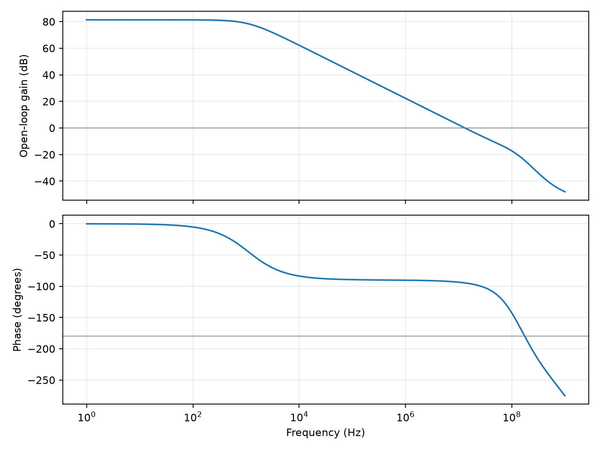
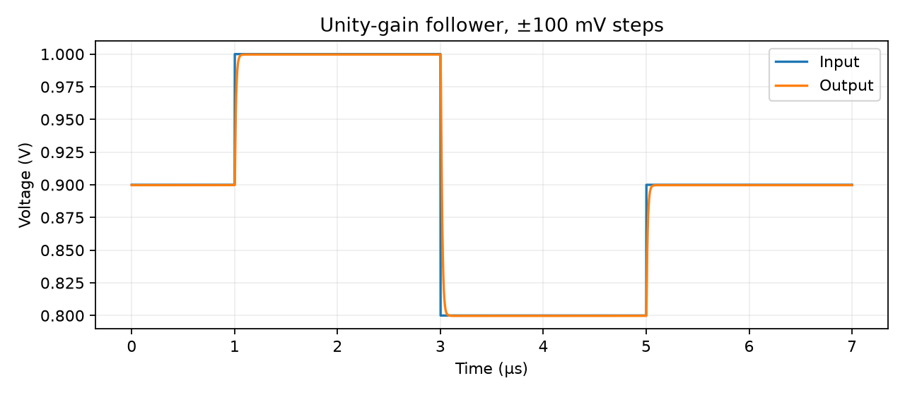

# MillerOTA — CMOS op-amp design and characterization

A two-stage, single-ended CMOS operational amplifier built from SKY130 1.8 V MOS devices. The study follows the relationship between bias current, transistor sizing, Miller compensation, capacitive loading, noise and closed-loop response.

**The amplifier core is transistor-level.** A supplied ideal reference current biases a diode-connected transistor/current-mirror network. This is schematic simulation, with no layout, extracted parasitics, fabricated hardware or measured silicon results.



## Measured simulation results

Nominal: TT, 1.8 V, 27 °C, 2 pF load, 2 pF compensation, 2 kΩ nulling resistor.

| Metric | Result |
|---|---:|
| Open-loop DC gain | 81.33 dB |
| Unity-gain frequency | 13.12 MHz |
| Unity-feedback phase margin | 85.38° |
| Quiescent power, reference included | 291.3 µW |
| Systematic follower offset | 270.7 µV |
| Positive / negative 100 mV step, 1% settling | 57.75 / 64.75 ns |
| Input-referred noise, 10 Hz–10 MHz | 100.68 µV RMS |

The **135-condition** matrix combines five process corners (TT/SS/FF/SF/FS), three supplies (1.71/1.80/1.89 V), three temperatures (−40/27/85 °C) and three loads (1/2/5 pF). All 135 meet the declared targets of ≥60 dB gain, ≥5 MHz unity-gain frequency and ≥50° phase margin. Worst cases are 74.89 dB gain, 10.56 MHz unity frequency and 69.42° phase margin. These minima may occur at different conditions.

## Reproduce

Install `ngspice` (`brew install ngspice`, or your Linux package manager), and Python 3.12.

```sh
python3 -m venv .venv
. .venv/bin/activate
python -m pip install -r requirements.txt
make verify
```

The full run takes about a minute depending on the machine. It executes 135 PVT/load analyses, a nine-point compensation sweep, nine common-mode operating points, nominal transient/noise analyses and eight tests. Generated decks and complete ngspice logs go to ignored `build/`; report JSON and figures go to `reports/`. CI repeats the characterization before tests.

## Design and validation

[The circuit](circuits/ota.spice) uses an NMOS differential input pair, PMOS mirror load, NMOS tail-current mirror and PMOS common-source output stage with an NMOS current sink. A series R–C compensation path connects the two gain stages. [Design notes](docs/design.md) describe the choices and measurement conventions.

A nine-point sweep exposes the bandwidth/stability tradeoff. At 2 kΩ, raising compensation from 0.5 to 2 pF trades roughly 39.2 to 13.1 MHz unity bandwidth for 41.2° to 85.4° phase margin. The deliberately undercompensated test candidate is rejected by the same margin criterion.

The test suite also checks source/model hashes, matrix completeness, DC offset/power, both transient edges, noise units and gain polarity. Original model files and license are retained in [models/](models/README.md).



## Scope

Results are model-based, not a production op-amp specification. Reference startup, reference accuracy, common-mode rejection, PSRR, distortion, random mismatch, layout and statistical yield have not been signed off. Common-mode sweeps are characterized but are not part of the 135-condition guarantee. The ideal reference and the testbench bias servo are explicit in the netlists. Noise-model warnings are retained in the raw logs rather than suppressed.
